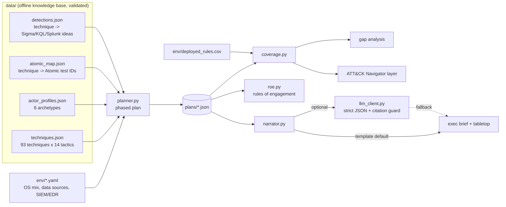

# AI-Assisted Adversary Emulation Planner

Turn a threat-intel question ("plan a purple-team exercise for a ransomware affiliate that targets healthcare") into an authorized, detection-focused test plan: phased ATT&CK techniques, Atomic Red Team test identifiers, expected telemetry, a detection checklist, a coverage gap analysis with an ATT&CK Navigator layer, a signable rules-of-engagement document, and an executive brief / tabletop script.

    

> **Planning and detection only.** This project never contains or generates exploit code, payloads or operational attack instructions. It references public Atomic Red Team test **identifiers** by name/number and describes the telemetry and detections a defender should see. Authorized testing of the owner's own systems only — see [`SCOPE.md`](SCOPE.md).

## Why this project exists

A SOC earns its keep by **detecting** adversary behaviour, and the only honest way to know whether it does is to emulate that behaviour and watch for the alert. My detection repos ([Sentinel](https://github.com/brooklynkid707-cmd/microsoft-sentinel-detection-engineering), [Splunk](https://github.com/brooklynkid707-cmd/splunk-threat-detection-lab), [mini-SIEM](https://github.com/brooklynkid707-cmd/siem-from-scratch)) ship the rules; this planner is the purple-team front end that decides **what to test, in what order, and how to measure coverage** — the threat-informed-defense loop that turns a threat model into a prioritized, authorized, measurable exercise.

## What it demonstrates

- **Threat-informed defense / purple teaming**: profile or technique list → phased plan (recon → impact) → controlled Atomic test → detection result → gap → new rule.
- **An offline ATT&CK knowledge base** (93 techniques across all 14 tactics, 6 actor archetypes, technique→Atomic-test-ID map, technique→detection-idea map) that is schema-validated in CI.
- **Environment-aware planning**: the plan is tailored to the OS mix, the telemetry actually collected and the SIEM/EDR, and flags detection **blind spots** where a technique's data source is not collected.
- **Coverage engineering**: compares the plan to a CSV of deployed rules → covered / partial / gap, a weighted coverage %, and an ATT&CK Navigator 4.5 layer.
- **Rules of engagement as code**: scope, authorization sign-off, blackout windows, ENDEX kill switch, data handling, high-risk-technique call-outs — generated from the plan.
- **A governed optional LLM**: rewrites the plan into an executive brief + tabletop script under a strict JSON contract, may only cite technique IDs in the plan, and falls back to a deterministic template on any breach.
- **Safety by construction**: no commands/payloads anywhere; high-risk steps require a snapshot and carry rollback notes.

| Feature | CompTIA Security+ (SY0-701) | MITRE ATT&CK | NIST CSF 2.0 |
|---|---|---|---|
| Phased emulation planner (recon→impact) | 2.4 Indicators of malicious activity; 4.4 Security alerting and monitoring | whole kill chain, e.g. T1566.001, T1003.001, T1486 | IDENTIFY (ID.RA), DETECT (DE.AE) |
| ATT&CK knowledge base + Atomic test mapping | 1.2 / 2.1 Threat actors and TTPs; 2.4 | T1059.001 PowerShell, T1558.003 Kerberoasting, T1490 Inhibit System Recovery | IDENTIFY (ID.RA), DETECT |
| Coverage gap analysis + Navigator layer | 4.4 Monitoring coverage; 5.2 Risk management | mapping across all tactics | IDENTIFY (ID.RA), DETECT (DE.CM) |
| Rules of engagement generator | 5.1 Security governance; 4.8 Incident response (scope, authorization) | - | GOVERN (GV.PO, GV.RR) |
| Environment-aware blind-spot detection | 4.4 Log aggregation / collection gaps; 3.3 Secure infrastructure (logging) | per-technique data sources | PROTECT (PR.PS), DETECT (DE.CM) |
| Threat-actor profiles (archetypes) | 2.1 Threat actors, attributes and motivations | per-profile technique sets | IDENTIFY (ID.RA) |
| Governed LLM brief / tabletop (contract + citation guard) | 4.7 Automation and orchestration; 5.1 governance | citations to plan technique IDs only | GOVERN, DETECT |
| Schema validator / pytest / offline-by-default | 4.7 Automation (guard rails); 5.4 compliance (metrics) | - | GOVERN (GV.PO) |

## Architecture



More in [`docs/methodology.md`](docs/methodology.md).

## Quickstart

```bash
git clone https://github.com/brooklynkid707-cmd/ai-adversary-emulation-planner.git
cd ai-adversary-emulation-planner
pip install --break-system-packages -r requirements.txt   # pyyaml + pytest

make all        # build KB -> validate -> plan -> coverage -> roe -> brief -> test
```

Individual commands:

```bash
python scripts/build_kb.py                                                   # (re)generate data/*.json
python -m aep validate-kb                                                    # schema + integrity checks
python -m aep list-profiles                                                  # the 6 actor archetypes
python -m aep plan     --profile ransomware-affiliate --env env/hospital.yaml --out plans/
python -m aep coverage --plan plans/ransomware-affiliate-plan.json --rules env/deployed_rules.csv --out plans/
python -m aep roe      --plan plans/ransomware-affiliate-plan.json --out plans/ --authorized-by "J. Scirica (SEC-42)"
python -m aep brief    --plan plans/ransomware-affiliate-plan.json --backend template --out plans/
```

Ad-hoc technique set instead of a profile:

```bash
python -m aep plan --techniques T1059.001,T1003.001,T1486 --env env/enterprise.yaml --out plans/custom.json
```

## Sample output

Captured from the commands above (Python 3.13, Linux):

```text
$ python -m aep plan --profile ransomware-affiliate --env env/hospital.yaml --out plans/
plan: Purple-team emulation - Group A - Ransomware Affiliate (healthcare/finance)
techniques: 30   phases: 12
  initial-access          3  T1566.001, T1133, T1078
  execution               2  T1059.001, T1569.002
  persistence             2  T1053.005, T1543.003
  privilege-escalation    2  T1548.002, T1134
  defense-evasion         2  T1562.001, T1070.001
  credential-access       3  T1003.001, T1558.003, T1110.003
  discovery               3  T1087.002, T1018, T1482
  lateral-movement        4  T1021.001, T1021.002, T1550.002, T1570
  collection              2  T1560.001, T1005
  command-and-control     2  T1071.001, T1105
  exfiltration            2  T1567.002, T1041
  impact                  3  T1489, T1490, T1486
wrote plans/ransomware-affiliate-plan.json

$ python -m aep coverage --plan plans/ransomware-affiliate-plan.json --rules env/deployed_rules.csv --out plans/
deployed rules: 20   plan techniques: 30
coverage: 48.3%   covered=14 partial=1 gap=15

technique    status    rules
------------------------------------------------------------
T1078        covered   sec-4648-explicit-credentials-lateral, signin-high-risk-successful
T1059.001    covered   sec-4688-encoded-powershell
T1562.001    partial   sec-4719-audit-policy-changed
T1003.001    covered   mde-lsass-memory-dump
T1558.003    covered   kerberoasting-rc4-tgs
T1021.001    covered   rdp-to-multiple-hosts
T1489        gap       -
T1490        covered   shadow-copy-deletion
T1486        covered   mass-file-encryption
...
GAPS (15): T1566.001, T1133, T1569.002, T1548.002, T1134, T1018, T1482, T1550.002, T1570, T1560.001, T1005, T1567.002, T1041, T1105, T1489

wrote plans/purple-team-emulation-...-coverage.json
wrote plans/purple-team-emulation-...-navigator-layer.json
```

### Coverage result (ransomware-affiliate vs the sample deployed rules)

| Status | Count | Examples |
|---|---|---|
| **covered** | 14 | T1003.001 (LSASS), T1486 (ransomware encryption), T1110.003 (spray), T1021.002 (SMB fan-out) |
| **partial** | 1 | T1562.001 — only the parent audit-policy rule exists, not tool-tampering |
| **gap** | 15 | T1566.001 (spearphish attachment), T1550.002 (pass-the-hash), T1041 (C2 exfil), T1489 (`draft` rule, ignored) |
| **weighted coverage** | **48.3%** | `(14 + 0.5x1) / 30` |

```text
$ python -m pytest -q
.........................................                                [100%]
41 passed in 0.18s
```

A full technique record and the gap findings are walked through in [`docs/example-plan.md`](docs/example-plan.md).

## Project layout

```text
ai-adversary-emulation-planner/
├── aep/
│   ├── kb.py              knowledge-base loader + schema validation
│   ├── environment.py     env/*.yaml model (OS mix, data sources, SIEM/EDR)
│   ├── planner.py         phased plan builder (recon -> impact)
│   ├── coverage.py        gap analysis + ATT&CK Navigator 4.5 layer
│   ├── roe.py             rules-of-engagement document generator
│   ├── narrator.py        exec brief + tabletop (template / governed LLM)
│   ├── llm_client.py      optional OpenAI-compatible backend (urllib)
│   └── cli.py             plan | coverage | roe | brief | validate-kb | list-profiles
├── data/                  techniques / actor_profiles / atomic_map / detections (JSON)
├── env/                   hospital.yaml, enterprise.yaml, deployed_rules.csv
├── scripts/
│   ├── build_kb.py        regenerates data/*.json (the curated KB source)
│   └── mock_llm_server.py offline OpenAI-compatible endpoint (+ --rogue)
├── docs/                  methodology, knowledge-base, navigator, example-plan
├── tests/                 41 pytest tests (KB, planner, coverage, ROE, narrator, CLI, Navigator)
├── plans/                 generated output (gitignored except .gitkeep)
├── SCOPE.md  README.md  LICENSE  Makefile  requirements.txt  pytest.ini
```

## Detection / analysis details

**How the plan is built.** Selected techniques are grouped into ATT&CK tactics and emitted in strict kill-chain order (`reconnaissance → … → impact`); empty phases are dropped. Each technique becomes a record with an objective, the mapped Atomic Red Team test IDs, prerequisites, expected telemetry, a detection checklist, success criteria, rollback notes and a risk rating. Risk is derived from the tactic (impact / credential-access / defense-evasion / priv-esc / lateral / exfil = high) and is bumped to high when the environment cannot observe the technique at all.

**Environment awareness.** Each technique's ATT&CK data sources are checked against the environment's collected sources. `hospital.yaml` deliberately omits Module (Sysmon 7), WMI (Sysmon 19-21) and DNS query logs, so techniques that rely on them (DLL side-loading, WMI event subscription, DNS C2) surface a `blind_spots` list and their success criterion becomes "confirm the gap," not "expect an alert."

**Coverage math.** A deployed rule covers a technique on an **exact** technique-ID match; a rule on the parent (or a sibling sub-technique) counts as **partial**; anything else is a **gap**. Disabled/`draft` rules are ignored (that is why `T1489` is a gap despite a rule existing). Weighted coverage counts a partial as half: `(covered + 0.5·partial) / total`.

**False-positive / honesty notes.** The detection logic in the KB is **pseudo-logic for planning** — the authoritative, tuned rules live in the detection repos. Atomic test numbers can drift upstream, so they are pointers to verify, not frozen truth. Profiles are archetypes, not attributed intel. These limits are spelled out in [`docs/knowledge-base.md`](docs/knowledge-base.md).

## How AI is used here — and how it is kept in check

The LLM is **optional and off by default**. `brief --backend template` is fully deterministic and offline; the model only ever *rewrites* planning content into an executive brief and a tabletop script.

- **Hallucination / scope creep.** The model receives the plan's phases and an explicit ALLOWED list of technique IDs, and must return a single JSON object matching a fixed contract. `validate_narration()` rejects the output if it cites **any** technique ID not in the plan — in the JSON `citations`, in a scene's `techniques`, or inline in the prose. On any breach the narrator discards the model output and uses the template, recording the reason. This is demonstrated by `scripts/mock_llm_server.py --rogue` and by `test_narrator.py`.
- **Prompt injection / untrusted input.** The model never sees commands or payloads — only technique IDs and names — so there is nothing operational for it to leak or amplify. The citation allow-list means a manipulated model cannot introduce new techniques into a plan.
- **Data handling.** The backend is configured by env vars (`AISEC_LLM_URL`, `AISEC_LLM_KEY`, `AISEC_LLM_MODEL`) over stdlib `urllib`; with no URL set, the LLM path short-circuits to the template. No plan data leaves the machine unless an endpoint is explicitly configured. The mock server lets the whole contract be exercised offline.
- **Human-in-the-loop.** The brief and tabletop are drafts for a human test lead to review; the ROE still requires physical sign-off, and no execution happens from this tool at all.

**What the mock backend cannot show:** real model quality, latency, or token cost — it returns a fixed, contract-shaped response to prove the plumbing and the guard rails, not to simulate a language model.

## What I learned / Next steps

**Learned**

- Writing the KB validator first paid off immediately: it caught a malformed Atomic identifier (`T1048.003-2` filed under `T1048`) in my own data before any test ran — the same "schema fails the PR, not the deployment" lesson from my Sentinel repo.
- Coverage is only meaningful if "covered" is strict. Treating a parent-technique rule as full coverage would have hidden real gaps, so parent/sibling matches are explicitly `partial`, and `draft`/disabled rules do not count.
- The safest place to put an LLM in a security tool is *after* the facts are fixed: let it phrase a plan it cannot change, and make the citation allow-list the thing that is tested, not the prose.
- Modelling the environment's collected data sources turned "detection coverage" from a yes/no into "covered, or a known blind spot" — which is how a real SOC talks about it.

**Next steps**

- Emit the plan as an Atomic Red Team runbook manifest (ordered test IDs + per-step detection assertions) for an operator to execute in an isolated range.
- Pull deployed-rule technique IDs directly from the Sentinel/Splunk repos' coverage docs so `coverage` runs against live rule inventories.
- Add a post-exercise command that ingests which detections actually fired and diffs expected-vs-observed into a results Navigator layer.
- Broaden the KB toward cloud/identity (Entra, AWS) and macOS/Linux techniques, with their own data-source models.

---

JP Scirica — CompTIA Security+ | linkedin.com/in/jp-scirica
